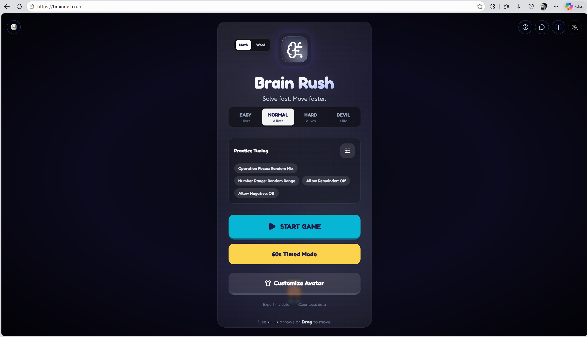

# Brain Rush（头脑冲刺）

> 免费的儿童口算训练 × 英语单词反应小游戏。题目在上方，答案从天上掉下来——接对得分，躲开错误，60 秒冲高分。



**[brainrush.run](https://brainrush.run)** · 免费 · 纯前端 · 离线可玩 · 数据只存本地浏览器 · *[English](README.en.md)*

## 为什么做

Brain Rush 不是把练习册搬上网页，而是把**基础口算、英语词汇、反应速度**揉成一局很短的小游戏。

适合：

- 小学生做 3-5 分钟轻量练习
- 家长陪练时快速开一局
- 课堂外刷口算速度、单词反应和注意力
- 想要无登录、无上传、可离线使用的儿童学习小游戏

## 快速开始

```bash
npm install
npm run dev        # http://localhost:3000
npm run build      # 生产构建（含类型检查 + 测试）
```

## 怎么玩

题目显示在顶部，多个答案方块从空中掉落。控制底部角色左右移动，接住正确答案得分，碰到错误答案或漏题扣血。

- **操作**：键盘 ← → 或 A / D，移动端拖拽
- **普通模式**：血量归零结束
- **60 秒计时模式**：无限命 + 更快节奏，适合短局刷分

| 难度 | 血量 | 特点 |
| --- | --- | --- |
| Easy | 4 | 速度慢、题目基础，适合入门 |
| Normal | 3 | 默认模式，兼顾反应与口算 |
| Hard | 2 | 更快、选项更多、题目更难 |
| Devil | 1 | 一次失误即结束 |

## 两种训练模式

### 数学冲刺

覆盖加减乘除。菜单内可同屏调节：

- **题型倾向**：随机混合 / 偏向加减 / 偏向乘除
- **数值范围**：随机 / 十以内 / 二十以内 / 五十以上
- **开关**：是否允许余数、是否允许负数
- **快捷模板**：均衡 · 20 内加减 · 乘除专项 · 余数除法 · 负数挑战

### 单词冲刺

支持英译中、中译英、句子填空。菜单内可调节出题方向和是否出现完形填空。

词库本地维护（`data/vocab.ts` + `data/cloze.ts`），离线可用，不依赖外部 API。难度分层控制取词池，高难度出现更多候选和完形题。

## 关键特性

- **60 秒 mental math challenge**：短局、高反馈，适合反复刷成绩
- **错题本**：本地记录数学与单词错题，方便回看
- **本地隐私**：最高分、错题、60 秒记录、角色外观、题目偏好全部存在 `localStorage`
- **像素角色**：8 种 Canvas 2D 像素角色，通过分数逐步解锁
- **零账号依赖**：不登录、不上传、不接外部题库服务

## 像素角色

8 种纯 Canvas 2D 手绘的像素角色，通过游戏分数逐步解锁：

| 分数 | 角色 | 头部 | 身体 | 腿部 |
| --- | --- | --- | --- | --- |
| 0 | Runner 冲刺 | 😄 | 🎽 | 👟 |
| 8 | Ninja 忍者 | 🥷 | 🥋 | 🥾 |
| 16 | Skater 滑板 | 😎 | 🧥 | 🛹 |
| 24 | Robot 机器人 | 🤖 | 🔋 | 🦿 |
| 32 | Astronaut 宇航员 | 👩‍🚀 | 🛰️ | 🥾 |
| 40 | Scientist 科学家 | 🧠 | 🥼 | 🧪 |
| 50 | Hero 英雄 | 🦸 | ⚡ | 🥾 |
| 65 | Boss | 😈 | 🛡️ | 🔥 |

> 角色绘制合约 → [pixel-character-spec.md](docs/pixel-character-spec.md)

## 技术栈

React 19 · TypeScript · Vite · Tailwind CSS · Canvas 2D · animejs · Web Audio API

部署在 Cloudflare Pages，GitHub push 即上线。

---

文档 · [像素角色 spec](docs/pixel-character-spec.md) · [开发日志](docs/progress.md)
